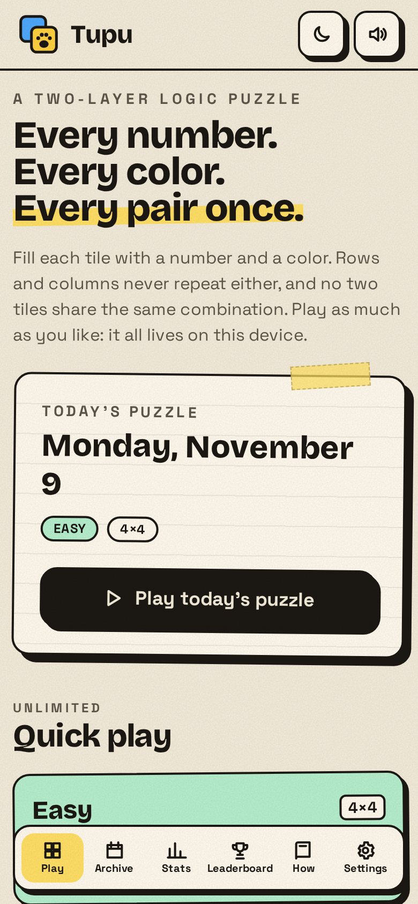
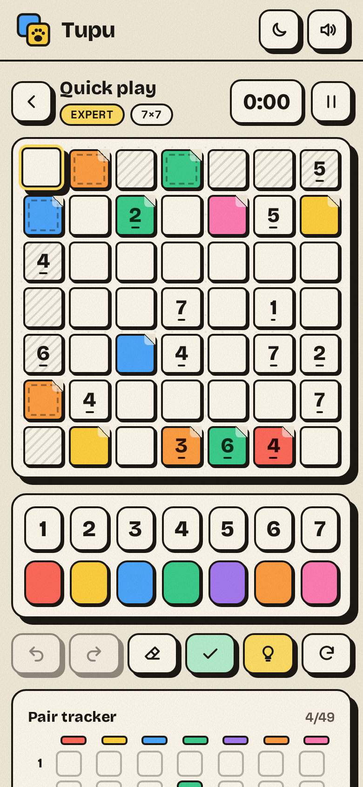
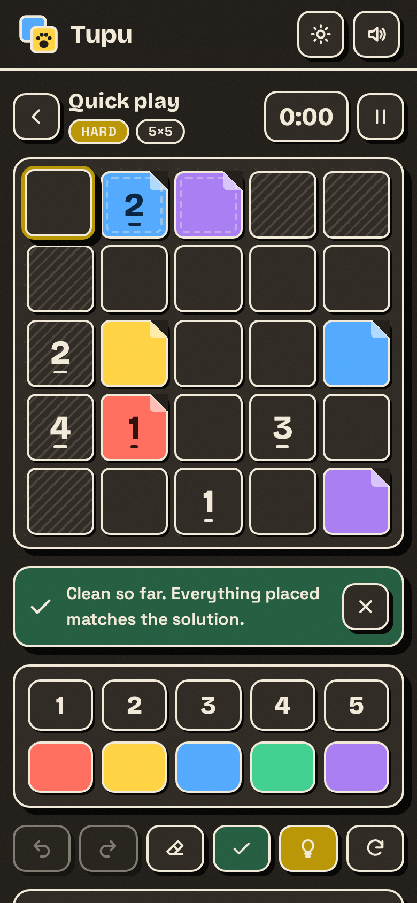
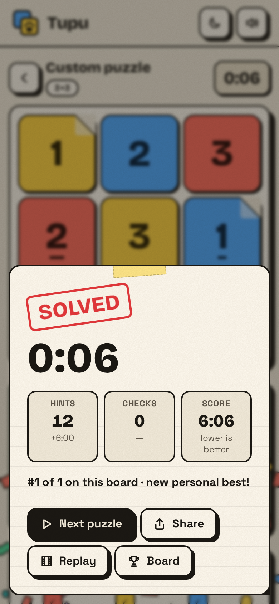
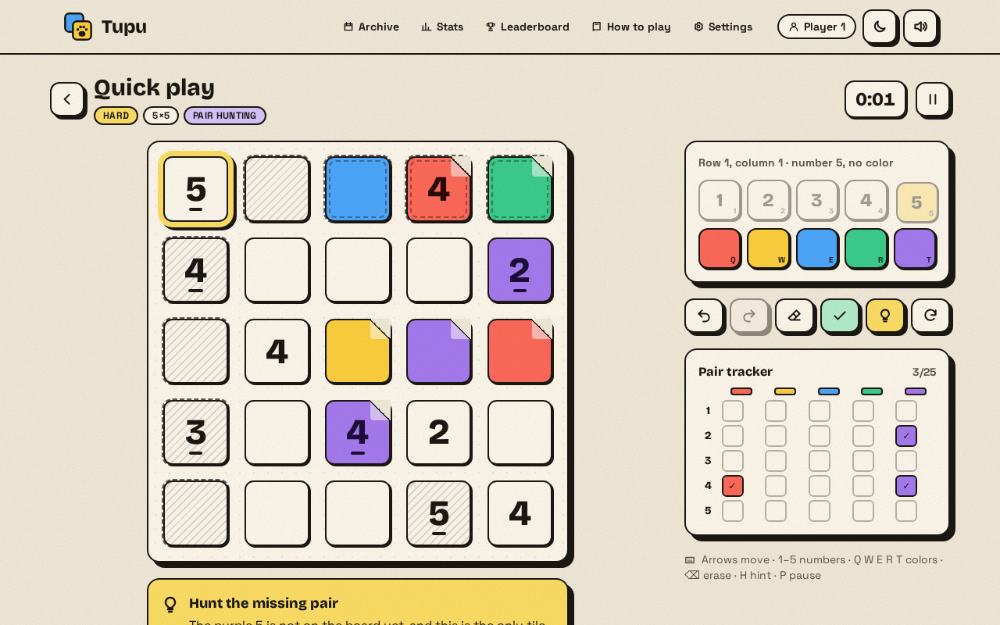

# Tupu

A local-first logic puzzle of numbers and colors. Each tile takes a number and a color: rows and columns never repeat either, and every number and color pair appears exactly once on the board (a Graeco-Latin square). There is no daily limit and nothing leaves the browser.

<p>
  
  
  
  
</p>


## Features

- **Modes:** a daily puzzle whose difficulty follows the weekday, unlimited quick play in five difficulties (Easy 4×4 to Expert 7×7), and custom puzzles with any supported size (3, 4, 5, 7, 8, 9), logic level, clue density and a shareable seed.
- **Archive:** every past daily is playable from a calendar.
- **Fair puzzles:** a logical solver grades every puzzle by the hardest deduction it needs (line logic, pair logic, pair hunting, deep logic) and guarantees a unique solution reachable without guessing.
- **Help that teaches:** hints explain the next deduction and highlight the tiles that justify it; checks cross out wrong values; a pair tracker shows which combinations are on the board; rule breaks can be outlined live.
- **Players and leaderboard:** several local players, ranked per board by time plus hint and check penalties.
- **Stats, streaks and replays** of every solve, a guided tutorial, keyboard controls, synthesized paper sounds, dark mode and color-vision shapes.
- **Local-first storage:** SQLite (wa-sqlite on OPFS, in a worker) with backup download and restore.
- **Installable PWA that works offline:** a service worker precaches the whole build (app, SQLite WebAssembly, worker, fonts, icons). After the first visit there is nothing to sign in to and no network needed. Phone layouts keep the board, keypad and actions on one screen.

## Stack

Vite, React and Tailwind CSS for the UI, with TanStack Router, Query, Form, Table, Charts, Hotkeys, Pacer and Store; Effect 4 for services, layers and schemas; Kysely as the query builder and migrator, executed through the Effect `SqlClient`. Lint and format with Oxlint and Oxfmt; Effect diagnostics come from `@effect/tsgo` on TypeScript 7.

| Path           | Role                                                                   |
| -------------- | ---------------------------------------------------------------------- |
| `src/domain`   | Square construction, logical solver, generator, game session reducer.  |
| `src/db`       | Kysely dialect over the Effect `SqlClient`, migrations, SQLite worker. |
| `src/services` | Effect services: games, players, settings, stats, leaderboard, sound.  |
| `src/ui`       | Atom runtime, components and pages.                                    |
| `test`         | Vitest suites; services run against a real `node:sqlite` database.     |

## Development

With Nix, run `direnv allow` once (or `nix develop path:./nix`). Otherwise use Node 24 and pnpm 12.

```sh
pnpm install
pnpm dev          # http://localhost:5173
pnpm check        # tests, lint, typecheck, Effect diagnostics, formatting
pnpm build
pnpm preview      # production build with the service worker, http://localhost:4173
```

The service worker and OPFS storage need a secure context: `localhost` or HTTPS. To play on a phone, serve `dist/` from any static HTTPS host, or open the preview through an HTTPS tunnel. A plain `http://<lan-ip>` address will not work.

## Deploy

The build is a set of static files; there is no server-side state. Everything a player owns stays in their browser.

### Cloudflare (Alchemy)

[`alchemy.run.ts`](alchemy.run.ts) defines a `Tupu` stack: `Cloudflare.Website.StaticSite` runs `pnpm build` and serves `dist/` as Worker static assets. Cache headers come from [`public/_headers`](public/_headers). Alchemy keeps its state in your Cloudflare account.

```sh
pnpm cf:login                          # once: connect a Cloudflare account to the Alchemy profile
pnpm deploy                            # alchemy deploy --stage prod, prints the workers.dev URL
TUPU_DOMAIN=tupu.example.com pnpm deploy   # optional custom domain (the zone must be on Cloudflare)
pnpm destroy                           # remove the stack
```

In CI, set `CLOUDFLARE_ACCOUNT_ID` and `CLOUDFLARE_API_TOKEN` instead of using a profile.

### Docker

The image builds the app, then runs a small Effect HTTP server on Node ([`server/main.ts`](server/main.ts), bundled into one file by `pnpm build:server`). It serves `dist/` with SPA fallback, ETags, the right MIME types for WebAssembly and the manifest, and per-path cache headers. It listens on plain HTTP port 8080 as the unprivileged `node` user; put your own reverse proxy in front for HTTPS, which the PWA and OPFS storage require on phones. Nothing is stored server-side, so no volume is needed. `GET /healthz` answers `ok`.

```sh
docker compose up -d --build        # http://localhost:8080
PORT=3000 docker compose up -d --build
```

| Variable      | Default     | Purpose                        |
| ------------- | ----------- | ------------------------------ |
| `PORT`        | `8080`      | Port the server listens on.    |
| `HOST`        | `0.0.0.0`   | Interface the server binds to. |
| `STATIC_ROOT` | `/app/dist` | Directory with the built app.  |

Without Docker: `pnpm build && pnpm build:server && pnpm start`, or `pnpm serve` to run the server from source.
